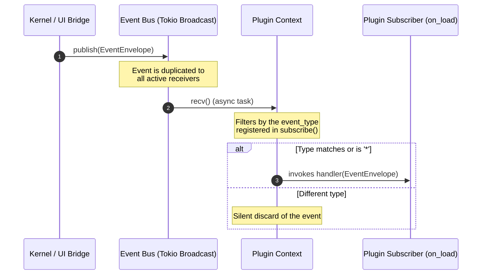

# Architecture Specification: Zavik

This document describes the internal communication flows, physical dependency
rules between crates, and the operational lifecycle of plugins in **Zavik**.

[English](ARCHITECTURE.md) · [Português (Brasil)](ARCHITECTURE.pt-BR.md)

---

## 1. Dependency Rules and Report (Dependency Rules)

To preserve the **Clean Architecture** principle and prevent the Kernel or
the SDK from coupling to external frameworks (Tauri, SQLite, etc.), the Rust
Workspace dependency tree follows strict direction rules:

```text
               ┌──────────┐
               │  shared  │
               └────▲─────┘
                    │
         ┌──────────┴──────────┐
         │       events        │
         └──────────▲──────────┘
                    │
         ┌──────────┴──────────┐
         │        sdk         │
         └────▲───────────▲────┘
              │           │
         ┌────┴───┐   ┌───┴───┐
         │ kernel │   │ core  │
         └────────┘   └───────┘
```

### Crate Dependency Report
1.  **`shared`**: Basic leaf crate. Depends only on the Rust Standard
    Library (`std`), `uuid` and `chrono`.
2.  **`events`**: Depends on `shared` and basic serializers (`serde`,
    `serde_json`). Has no Kernel dependencies or business rules.
3.  **`sdk`**: Depends on `events` (and transitively on `shared`). Has no
    dependencies on `kernel`, on a `database`, or on `tauri`.
4.  **`core`**: Depends on `sdk`, `events` and `shared`. Exempt from physical
    database or Tauri dependencies.
5.  **`kernel`**: Depends on `sdk`, `events` and `shared`. Exempt from
    business rules or GUI logic.

*   **Absolute Prohibition Rule**: any attempt to import `kernel` into `sdk`
    or `events` will produce a cyclic dependency error at compile time.

---

## 2. Flow: Kernel ➔ EventBus ➔ Plugin

Communication between the system's native components is choreographed
reactively through the `EventBus`.



### Fault Tolerance and Isolation
*   **Slow Subscribers**: each `EventBus` subscription runs in a dedicated
    async task (`tokio::spawn`). A slow plugin, or one performing heavy IO
    operations, does not block the Kernel from publishing new events to the
    other subscribers.
*   **Runtime Safety (No Panic)**: internal errors while a plugin processes an
    event payload (e.g. parsing failures) are captured via `Result` in the
    plugin execution linter. A plugin's processing panic does not take down
    the `EventBus` broadcast channel.

---

## 3. Flow: Plugin ➔ Capability

Plugins are organized into individual **Capabilities** to modularize
responsibilities and optimize loading.

```text
 ┌────────────────────────────────────────────────────────┐
 │                      Plugin Host                       │
 └──────────────────────────┬─────────────────────────────┘
                            │
        ┌───────────────────┼───────────────────┐
        ▼                   ▼                   ▼
┌───────────────┐   ┌───────────────┐   ┌───────────────┐
│   Detector    │   │   Analyzer    │   │   Executor    │
├───────────────┤   ├───────────────┤   ├───────────────┤
│ • detect()    │   │ • analyze()   │   │ • suggest()   │
└───────────────┘   └───────────────┘   └───────────────┘
```

1.  **Discovery**: the Kernel requests `plugin.capabilities()` to understand
    what resources the plugin provides.
2.  **Safe Cast**: the Kernel casts the plugin to the respective capability
    (e.g. `plugin.as_detector()`) only when that phase of Zavik's analysis
    cycle is active.
3.  **Execution**: the capability is called with structured arguments (e.g.
    file paths), returning clean data in a structured format.

---

## 4. Plugin Lifecycle

The lifecycle is centrally managed by the `PluginRegistry` in the Kernel and
consists of the following states and transitions:

```mermaid
state_diagram
    [*] --> Instantiated : Binary load
    Instantiated --> Registered : registry.register(plugin)
    Registered --> Loaded : Runs plugin.on_load(context)
    Loaded --> Active : Listening to events and ready for Capabilities
    Active --> Unloaded : registry.unregister(plugin)
    Unloaded --> [*] : Runs plugin.on_unload()
```

1.  **on_load(context)**: the Kernel provides a `PluginContext` instance to
    the plugin. The plugin uses this context to subscribe to the domain
    events it cares about (e.g. `project_opened`).
2.  **on_unload()**: called on Kernel shutdown or plugin deactivation. The
    plugin releases resources and removes its bus subscriptions.
