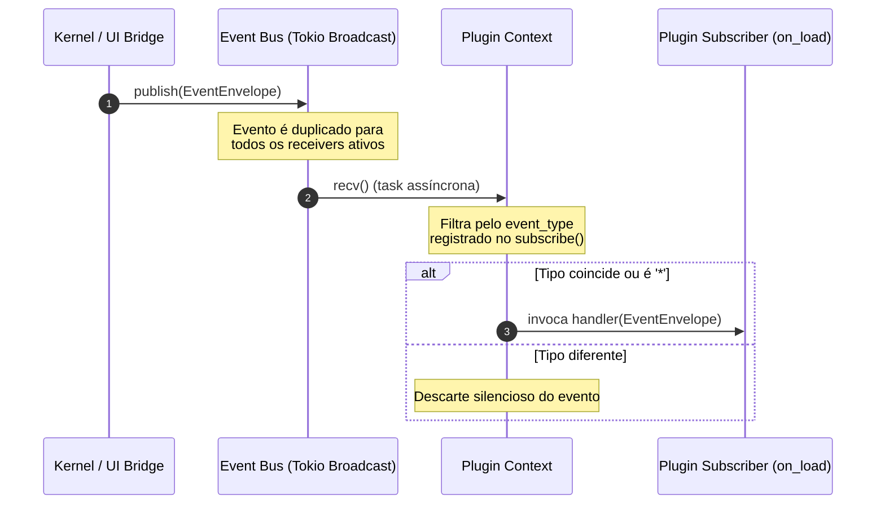

# Especificação de Arquitetura: DevForge

Este documento documenta os fluxos internos de comunicação, regras de dependências físicas entre crates e o ciclo de vida operacional de plugins no **DevForge**.

---

## 1. Regras e Relatório de Dependência (Dependency Rules)

Para preservar o princípio de **Clean Architecture** e impedir o acoplamento do Kernel ou do SDK a frameworks externos (Tauri, SQLite, etc.), a árvore de dependências do Rust Workspace segue regras rígidas de direção:

```text
               ┌──────────┐
               │  shared  │
               └────▲─────┘
                    │
         ┌──────────┴──────────┐
         │       events        │
         └──────────▲──────────┘
                    │
         ┌──────────┴──────────┐
         │        sdk         │
         └────▲───────────▲────┘
              │           │
         ┌────┴───┐   ┌───┴───┐
         │ kernel │   │ core  │
         └────────┘   └───────┘
```

### Relatório de Dependência dos Crates
1.  **`shared`**: Crate folha básico. Depende apenas do Rust Standard Library (`std`), `uuid` e `chrono`.
2.  **`events`**: Depende de `shared` e de serializadores básicos (`serde`, `serde_json`). Não possui dependências do Kernel ou de regras de negócio.
3.  **`sdk`**: Depende de `events` (e transitivamente de `shared`). Não possui dependências do `kernel`, de banco de dados (`database`), nem do `tauri`.
4.  **`core`**: Depende de `sdk`, `events` e `shared`. Isento de dependências de banco de dados físicos ou Tauri.
5.  **`kernel`**: Depende de `sdk`, `events` e `shared`. Isento de regras de negócio ou de lógica de interface gráfica.

*   **Regra de Proibição Absoluta**: Qualquer tentativa de importar `kernel` em `sdk` ou `events` gerará erro de dependência cíclica em tempo de compilação.

---

## 2. Fluxo: Kernel ➔ EventBus ➔ Plugin

A comunicação entre os componentes nativos do sistema é coreografada de forma reativa através do `EventBus`.



### Tolerância a Falhas e Isolamento
*   **Assinantes Lentos**: Cada inscrição do `EventBus` roda em uma tarefa assíncrona dedicada (`tokio::spawn`). Um plugin lento ou que realize operações de IO pesadas não bloqueia a publicação de novos eventos do Kernel para os outros assinantes.
*   **Segurança de Runtime (Sem Pânico)**: Erros internos durante o processamento do payload de eventos por um plugin (ex: falhas de parsing) são capturados via `Result` no linter de execução do plugin. O pânico de processamento de um plugin não derruba o canal de broadcast do `EventBus`.

---

## 3. Fluxo: Plugin ➔ Capability

Os plugins são organizados por **Capabilities** (Capacidades) individuais para modularizar responsabilidades e otimizar carregamento.

```text
 ┌────────────────────────────────────────────────────────┐
 │                      Plugin Host                       │
 └──────────────────────────┬─────────────────────────────┘
                            │
        ┌───────────────────┼───────────────────┐
        ▼                   ▼                   ▼
┌───────────────┐   ┌───────────────┐   ┌───────────────┐
│   Detector    │   │   Analyzer    │   │   Executor    │
├───────────────┤   ├───────────────┤   ├───────────────┤
│ • detect()    │   │ • analyze()   │   │ • suggest()   │
└───────────────┘   └───────────────┘   └───────────────┘
```

1.  **Descoberta**: O Kernel solicita `plugin.capabilities()` para entender quais recursos o plugin provê.
2.  **Cast Seguro**: O Kernel faz o cast do plugin para a respectiva capability (ex: `plugin.as_detector()`) apenas quando aquela fase do ciclo de análise do DevForge estiver ativa.
3.  **Execução**: A capability é chamada com argumentos estruturados (ex: caminhos de arquivo), retornando dados limpos em formato estruturado.

---

## 4. Ciclo de Vida de um Plugin

O ciclo de vida é gerenciado centralmente pelo `PluginRegistry` no Kernel e consiste nos seguintes estados e transições:

```mermaid
state_diagram
    [*] --> Instanciado : Carregamento do binário
    Instanciado --> Registrado : registry.register(plugin)
    Registrado --> Carregado : Executa plugin.on_load(context)
    Carregado --> Ativo : Escutando eventos e pronto para Capabilities
    Ativo --> Descarregado : registry.unregister(plugin)
    Descarregado --> [*] : Executa plugin.on_unload()
```

1.  **on_load(context)**: O Kernel fornece uma instância de `PluginContext` para o plugin. O plugin utiliza este contexto para assinar os eventos de domínio que lhe interessam (ex: `project_opened`).
2.  **on_unload()**: Chamado no desligamento do Kernel ou desativação de plugin. O plugin libera recursos e remove suas assinaturas do barramento.
